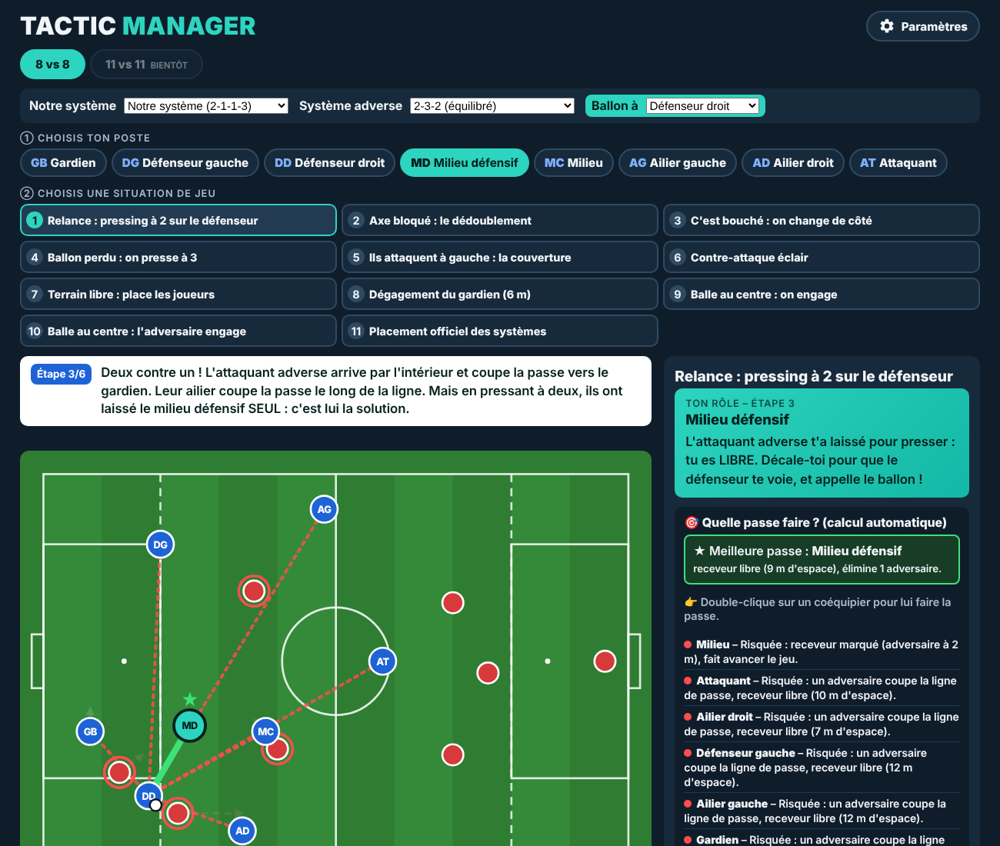

# Tactic Manager

Simulateur tactique de football à 8 pour apprendre aux jeunes joueurs (U11) **où se placer et comment se déplacer sans ballon**, selon les phases de jeu.



## Ce que fait l'application

- **Situations de jeu animées** étape par étape : relance sous pressing, dédoublement, changement de côté, perte de balle, couverture, contre-attaque.
- **Jeu libre** : double-clic sur un joueur pour faire une passe ; les adversaires réagissent, et c'est toi qui places tes joueurs.
- **Calcul automatique de la meilleure passe** : lignes vertes (sûres), orange (possibles), rouges (risquées).
- **Systèmes de jeu du foot à 8** : notre système (2-1-1-3), 2-3-2, 2-4-1, 3-2-2, 3-3-1, avec leur placement officiel.
- **Règles du foot à 8** : zone protégée au dégagement du gardien (ligne des 13 m), engagement à 6 m, tir au but.
- **Adversaire réglable** : force du pressing (niveaux 1 à 3), jeu automatique.

## Lancer l'application

Aucune installation n'est nécessaire.

- **Le plus simple** : double-clique sur `index.html`, il s'ouvre dans ton navigateur.
- **Avec VS Code** (recommandé) : installe l'extension **Live Server**, fais un clic droit sur `index.html` puis **« Open with Live Server »**. La page se recharge toute seule à chaque modification.

## Organisation des fichiers

```
tactic-manager/
├── index.html                      La page (structure HTML)
├── css/
│   └── style.css                   Toutes les couleurs, tailles et mises en page
├── js/
│   ├── donnees/
│   │   ├── situations.js           Les situations de jeu (positions, consignes)
│   │   └── systemes.js             Les systèmes de jeu (2-3-2, 3-3-1…)
│   ├── moteur/
│   │   ├── 1-terrain-et-animation.js     Dessin du terrain, animation, textes
│   │   ├── 2-souris-et-reactions.js      Déplacer les joueurs, réaction des adversaires
│   │   ├── 3-analyse-des-passes.js       Calcul de la meilleure passe
│   │   ├── 4-placement-et-regles.js      Placement automatique, pressing, règles
│   │   └── 5-actions-tir-adversaire.js   Passes, tir au but, adversaire automatique
│   └── main.js                     Démarrage de l'application
└── docs/
    └── capture.png                 Image utilisée dans ce README
```

Les fichiers JavaScript sont chargés **dans l'ordre** indiqué en bas de `index.html` : chaque fichier peut utiliser ce qui est défini dans les précédents.

## Modifier l'application

| Je veux… | Fichier à ouvrir |
|---|---|
| changer une couleur, une taille, la police | `css/style.css` (couleur principale : `--accent` en haut du fichier) |
| modifier ou ajouter une situation de jeu | `js/donnees/situations.js` |
| modifier un système de jeu ou en ajouter un | `js/donnees/systemes.js` |
| changer les règles de calcul des passes | `js/moteur/3-analyse-des-passes.js` |
| changer la façon dont les adversaires pressent | `js/moteur/4-placement-et-regles.js` (objet `PRESSING`) |

**Repères sur le terrain** : `x` va de 0 (notre but) à 100 (but adverse), `y` va de 0 (notre côté gauche) à 64 (notre côté droit). 1 unité ≈ 0,65 m.

## Feuille de route

- [x] Football à 8
- [ ] Football à 11

---
Projet personnel en HTML, CSS et JavaScript, sans dépendance.
